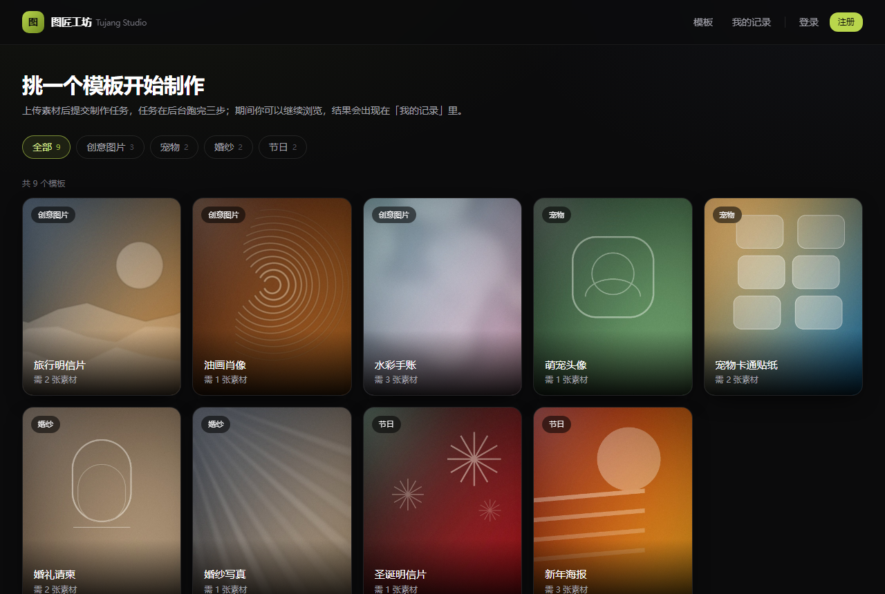
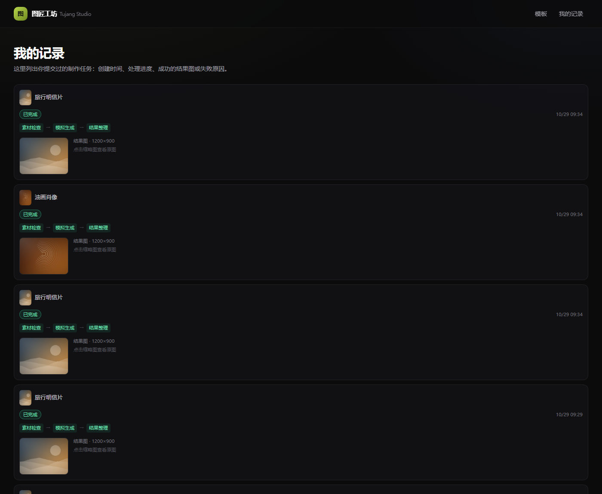

# 图匠工坊 · Tujang Studio

> 素材制作网站：浏览模板 → 上传素材 → 提交制作任务 → 后台异步执行 → 查看历史与结果。
> 小影科技 2027 校招题。

**验收版本：tag `v1.0.0`**（`git rev-parse v1.0.0` 取完整 commit hash）
· 后端 53 例 + 前端 38 例测试 · 冷启动验证见 [§7.1.1](#711-容器冷启动实测记录) 与 [§7.1.2](#712-干净目录克隆实测验收者视角)
· 需求对照与"已验证 / 未验证"见 [§7.1](#71-需求对照)

---

## 这个项目在做什么

制作流程不调用任何真实 AI。模板、素材与"生成结果"都是可预期的模拟数据，
真正做出来的是**后端多步骤异步处理**与**前端异步状态管理**这两件事：

```
POST /api/tasks ──> 202 + 完整任务对象（不等制作完成）
                       │
                       └─ 后台线程池：ASSET_CHECK → GENERATE → FINALIZE
                          每步把「阶段 + 状态」写入 MySQL，失败即中断
前端轮询 GET /api/tasks/{id}（纯只读）──> 阶段推进 / 成功结果 / 失败原因
刷新页面 ──> 从 MySQL 恢复历史，未完成任务继续跟踪
```

接口契约见 [docs/api.md](docs/api.md)，它是前后端的唯一真源。
分阶段实施计划与需求追溯矩阵见 [plan.md](plan.md)。

---

## 当前进度

| 阶段 | 内容 | 状态 |
|---|---|---|
| P0 | 仓库骨架、接口契约、数据库与种子数据、Compose、前后端空工程（链路打通） | ✅ 完成 |
| P1 | 模板列表 / 分类筛选 / 详情页 | ✅ 完成 |
| P2 | 素材上传（预览、替换、移除、校验） | ✅ 完成 |
| P3 | 提交受理 + 三步异步执行 + 状态查询 | ✅ 完成 |
| P4 | 前端任务状态机、轮询生命周期、历史与刷新恢复 | ✅ 完成 |
| P5 | 失败注入与耗时调节 | ✅ 完成 |
| P6 | 用户身份与个人记录 | ✅ 完成 |
| P7 | 测试、CI、容器交付、README 定稿 | ✅ 完成 |
| P8 | 冷启动验收与收尾 | ✅ 完成 |



---

## 快速开始

### 方式一：Docker Compose（推荐，评审用）

前置：Docker Desktop / Docker Engine + Compose v2。**不需要**本机装 JDK、Node、MySQL。

```bash
cp .env.example .env      # 可选；端口冲突时改 MYSQL_PORT / API_PORT / WEB_PORT
docker compose up --build
```

首次启动会：拉镜像 → 构建前后端 → 建库建表并灌种子数据 → 按健康检查顺序启动。

| 服务 | 地址 | 说明 |
|---|---|---|
| Web | <http://localhost:3000> | 从页面进 |
| API | <http://localhost:8080> | 直接调接口 |
| MySQL | `localhost:3306` | 库名 `tujang`，账号 `tujang / tujang_pw` |

等三个服务都 `healthy` 后打开 <http://localhost:3000>：

```bash
docker compose ps          # 三行都要是 healthy
```

### 方式二：本地开发

前置：JDK 21、Node 22、pnpm 12、Docker（只用来跑 MySQL）。

```bash
# 1) 数据库（首次启动会自动建表 + 灌种子数据）
cp .env.example .env
docker compose up -d mysql

# 2) 后端（二选一）
cd backend
mvn -B -DskipTests package && java -jar target/tujang-studio-api-0.1.0.jar
# 或：mvn spring-boot:run

# 3) 前端（另开终端）
cd frontend
pnpm install
pnpm dev
```

> ⚠️ **Windows + 含中文/括号的项目路径**下，`mvn spring-boot:run` 会报
> `ClassNotFoundException: ...TujangStudioApplication`：Spring Boot Maven 插件为 fork
> 出的 JVM 组装 classpath 时无法正确处理非 ASCII 路径（`mvn test` 不受影响，它走 surefire）。
> 此时改用上面的 `java -jar`，或把项目放到纯 ASCII 路径。容器内路径是 `/app`，无此问题。

本机若 `3306` / `8080` 被占用，用环境变量改端口（见下节）。例如：

```powershell
$env:DB_PORT='3307'; $env:SERVER_PORT='8090'
java -jar target/tujang-studio-api-0.1.0.jar
```

前端只认一个变量 `BACKEND_URL`（写在 `frontend/.env.local`）：

```
BACKEND_URL=http://localhost:8090
```

浏览器**始终**访问同源的 `/api/**` 与 `/files/**`，由 Next 的 rewrite 转发到 `BACKEND_URL`，
因此不存在 CORS 配置，容器内外行为一致。

---

## 1. 技术版本与项目结构

### 1.1 版本

| 层 | 选型 | 版本 |
|---|---|---|
| 前端 | Next.js（App Router）/ React / TypeScript | 15.1.6 / 19.0.0 / 5.7.3 |
| 样式 | Tailwind CSS | 3.4.17 |
| 客户端状态 | Zustand | 5.0.3 |
| 后端 | Java + Spring Boot + MyBatis | 21 / 3.3.5 / 3.0.3 |
| 数据库 | MySQL | 8.0 |
| 前端测试 | Vitest + Testing Library | 2.1.8 / 16.1.0 |
| 后端测试 | JUnit 5 + Mockito（Spring Boot Test 提供） | 5.10.5 |
| 运行时 | Node / pnpm / Maven | 22 / 12.15.0 / 3.9.12 |
| 容器 | 构建镜像 `maven:3.9.9-eclipse-temurin-21`、`node:22-alpine`；运行镜像 `eclipse-temurin:21-jre-alpine`、`node:22-alpine`；数据库 `mysql:8.0` | — |

依赖版本已锁定：`frontend/pnpm-lock.yaml`、`backend/pom.xml`（父 POM 锁定传递依赖）。

> **后端必须用 JDK 21**。本机 PATH 上可能装着更高的 JDK，务必显式指定 `JAVA_HOME`。

### 1.2 目录结构

```
.
├─ frontend/                    Next.js 15 App Router
│  ├─ src/app/                  页面：列表 / 详情 / 历史 + error.tsx / not-found.tsx
│  ├─ src/components/           模板卡、上传位、任务卡、任务列表、顶栏
│  ├─ src/store/task-store.ts   Zustand：任务按 id 索引
│  ├─ src/hooks/                轮询、上传位、服务端数据合并
│  ├─ src/lib/                  api（浏览器）/ server-api（服务端）/ 校验 / 格式化
│  ├─ src/middleware.ts         首次访问发身份 Cookie
│  ├─ Dockerfile                三阶段：deps → build → runner
│  └─ next.config.ts            rewrites 代理 + distDir 分离
├─ backend/                     Spring Boot 3.3（Maven）
│  ├─ src/main/java/com/tujang/studio/
│  │  ├─ web/                   Controller、拦截器、统一异常处理
│  │  ├─ service/               模板 / 素材 / 任务 / 流水线 / 模拟配置 / 用户
│  │  ├─ mapper/                MyBatis 注解 SQL
│  │  ├─ support/               ULID、图片探测、存储、时间、Cookie
│  │  └─ config/                线程池、静态资源与拦截器注册
│  ├─ src/test/java/            9 个测试类，53 例
│  ├─ Dockerfile                两阶段：maven build → JRE 运行
│  └─ pom.xml
├─ db/01-schema.sql             表结构（含 CHECK 约束，兜住终态不变式）
├─ db/02-seed.sql               9 个模板 / 4 个分类
├─ seed/                        种子素材：covers / results / samples
├─ tools/gen_seed_assets.py     素材生成脚本（可复现，无第三方版权素材）
├─ docs/api.md                  接口契约（唯一真源）
├─ docs/demo.md                 7 段可直接复制的演示命令
├─ docs/ai-workflow.md          AI 工作流说明
├─ .github/workflows/ci.yml     CI：web / api / 镜像构建
├─ docker-compose.yml           mysql + api + web
├─ .env.example                 非敏感配置示例
└─ plan.md                      分阶段计划、需求矩阵、决策记录
```

### 1.3 构建 / 测试 / 启动命令一览

| 目的 | 命令 | 备注 |
|---|---|---|
| 全栈启动 | `docker compose up --build` | 评审路径 |
| 只看数据库 | `docker compose up -d mysql` | 本地开发用 |
| 后端测试 | `mvn -B -f backend/pom.xml test` | 53 例，不需要数据库 |
| 后端打包 | `mvn -B -f backend/pom.xml -DskipTests package` | 产出 `backend/target/tujang-studio-api-0.1.0.jar` |
| 后端启动 | `java -jar backend/target/tujang-studio-api-0.1.0.jar` | `SERVER_PORT` / `DB_PORT` 可覆盖 |
| 前端安装 | `pnpm --dir frontend install --frozen-lockfile` | 需 pnpm 12 |
| 前端测试 | `pnpm --dir frontend test` | 38 例 |
| 前端 lint | `pnpm --dir frontend lint` | ESLint + next/core-web-vitals |
| 前端类型检查 | `pnpm --dir frontend typecheck` | `tsc --noEmit` |
| 前端构建 | `pnpm --dir frontend build` | 产物在 `frontend/.next` |
| 前端启动（生产） | `pnpm --dir frontend start` | 需先 build |
| 前端开发 | `pnpm --dir frontend dev` | 产物在 `.next-dev`，与生产互不干扰 |

### 1.4 前后端与数据库如何连接

```
浏览器
  │  http://localhost:3000/api/**      （同源，无 CORS，Cookie 自动带）
  ▼
Next.js 3000  ──rewrite──▶  Spring Boot 8080  ──JDBC──▶  MySQL 3306
  │                              │
  │  服务端组件取数也走这条链路    └─ /files/**  静态暴露 seed 与 data
  └─ 浏览器直接访问 /api/**、/files/**
```

- 浏览器**不直连** Java：`/api/**`、`/files/**` 都由 Next 转发（`frontend/next.config.ts`）。
- 前端 → 后端的地址只有一个变量 `BACKEND_URL`：本地是 `http://localhost:8090`，
  容器内是 `http://api:8080`（服务名）。
- 后端 → 数据库用 `DB_HOST` / `DB_PORT` / `DB_NAME` / `DB_USER` / `DB_PASSWORD`。
- 容器内三个服务在同一个默认 bridge 网络，用服务名互相解析。

---

## 2. 配置项、数据库初始化与模拟数据

### 2.1 配置项（全部有默认值，无真实凭据）

| 变量 | 作用 | 默认值 | 写在哪 |
|---|---|---|---|
| `MYSQL_PORT` | MySQL 映射到宿主机端口 | `3306` | `.env` |
| `API_PORT` | 后端映射到宿主机端口 | `8080` | `.env` |
| `WEB_PORT` | 前端映射到宿主机端口 | `3000` | `.env` |
| `MYSQL_ROOT_PASSWORD` | MySQL root 密码（示例值） | `tujang_root_pw` | `.env` |
| `MYSQL_DATABASE` / `MYSQL_USER` / `MYSQL_PASSWORD` | 业务库与账号（示例值） | `tujang` / `tujang` / `tujang_pw` | `.env` |
| `SPRING_PROFILES_ACTIVE` | 后端 profile；`dev` 才有 `/api/dev/**` | `dev` | `.env` / 环境 |
| `BACKEND_URL` | 前端转发目标（构建期 + 运行期） | 本地 `http://localhost:8080`；容器 `http://api:8080` | `.env.local` / compose build arg |
| `SERVER_PORT` | 后端监听端口 | `8080` | 环境 |
| `DB_HOST` / `DB_PORT` / `DB_NAME` / `DB_USER` / `DB_PASSWORD` | 后端连库 | `localhost` / `3306` / `tujang` / `tujang` / `tujang_pw` | 环境 |
| `APP_STORAGE_DATA_DIR` | 运行时产物目录 | `./data`（容器 `/app/data`） | 环境 |
| `APP_STORAGE_SEED_DIR` | 只读种子素材目录 | `../seed`（容器 `/app/seed`） | 环境 |
| `APP_TASK_POOL_SIZE` / `APP_TASK_QUEUE_CAPACITY` | 后台线程池大小 / 队列长度 | `4` / `50` | 环境 |

`.env` 与 `frontend/.env.local` 都已 git-ignore；仓库里只有 [.env.example](.env.example)。
**没有真实凭据需要申请**：数据库密码是本地示例值，也没有调用任何外部服务。

### 2.2 数据库初始化

`db/01-schema.sql`（5 张表）与 `db/02-seed.sql`（9 个模板 / 4 个分类）挂在 MySQL 容器的
`/docker-entrypoint-initdb.d` 下，**只在数据卷为空时执行一次**，按文件名顺序。

```bash
# 从零重来（会删数据）
docker compose down -v && docker compose up --build
```

手动初始化（**必须带 `--default-character-set=utf8mb4`**，原因见「常见问题」）：

```bash
mysql --default-character-set=utf8mb4 -u root -p < db/01-schema.sql
mysql --default-character-set=utf8mb4 -u root -p < db/02-seed.sql
```

表：

| 表 | 作用 |
|---|---|
| `app_user` | 身份（`id` 即 Cookie 值） |
| `category` | 模板分类（4 个） |
| `template` | 模板（9 个，覆盖 1/2/3 张素材、仅 JPG、1MB 上限等差异） |
| `asset` | 上传素材（落盘路径、宽高、大小、归属） |
| `task` | 制作任务（状态、当前阶段、失败阶段与原因、结果 URL、模拟配置快照） |
| `task_asset` | 任务与素材的多对多（含顺序） |

`task` 表用 CHECK 约束兜住不变式：`SUCCEEDED` 必有结果、`FAILED` 必有失败原因、
两者不能并存。数据库层面拒绝"看起来成功但没有结果"的行。

### 2.3 模拟数据与素材

| 目录 | 用途 | 访问路径 |
|---|---|---|
| `seed/covers/` | 9 张模板封面 | `/files/seed/covers/{templateId}.jpg` |
| `seed/results/` | 9 张预置结果图 | `FINALIZE` 阶段复制到 `data/results/` 后以 `/files/results/...` 提供 |
| `seed/samples/` | 3 张可直接上传的示例照片 | 演示时手动选择 |

所有图片由 [tools/gen_seed_assets.py](tools/gen_seed_assets.py) 用 Pillow 程序化生成，
**不使用任何第三方素材**，无版权问题。重新生成：

```bash
python tools/gen_seed_assets.py     # 需要 Pillow
```

"生成"这一步的模拟方式：`FINALIZE` 从 `seed/results/` 里按模板挑一张预置图，
复制进 `data/results/` 并写入 `task.result_url`，所以"结果"是真的可访问的图片文件，
而不是前端拼出来的占位图。

---

## 3. 主要接口、任务状态与后台执行

完整字段见 [docs/api.md](docs/api.md)（唯一真源）。这里只列主干。

### 3.1 接口清单

| 方法 | 路径 | 作用 | 主要响应 |
|---|---|---|---|
| GET | `/api/health` | 健康检查 | `200 {status,app,time}` |
| GET | `/api/categories` | 分类与模板数 | `200 [{code,name,count}]` |
| GET | `/api/templates?category=` | 模板列表（可按分类筛） | `200 [{id,title,coverUrl,...}]` |
| GET | `/api/templates/{id}` | 模板详情 | `200 {...,acceptedMimeTypes,maxFileSizeBytes}` / `404 TEMPLATE_NOT_FOUND` |
| POST | `/api/uploads` | 上传一张素材（multipart） | `201 {assetId,url,mimeType,sizeBytes,width,height}` |
| DELETE | `/api/uploads/{assetId}` | 删除未使用素材 | `204` / `403` / `409 ASSET_IN_USE` |
| POST | `/api/tasks` | 提交制作任务 | **`202` + 完整 `TaskDto`（PENDING）** |
| GET | `/api/tasks/{id}` | 查询单个任务（**纯只读**） | `200 TaskDto` / `403 TASK_FORBIDDEN` |
| GET | `/api/tasks?limit=50` | 个人历史（创建时间倒序） | `200 [TaskDto]` |
| GET | `/api/me` | 当前身份 | `200 {userId,displayName,devTools}` |
| POST | `/api/dev/users/switch` | 切换/切回用户（**仅 dev**） | `200` + `Set-Cookie` |
| GET / POST | `/api/dev/simulation` | 读取 / 设置失败与耗时（**仅 dev**） | `200 {failStep,perStepDurations,applyTo}` |
| GET | `/files/**` | 种子素材与结果图 | `200 image/jpeg` |

错误统一为 `{code,message,fields?}`，HTTP 状态码与错误码的对应表见契约 §0.6；
500 只返回 `INTERNAL_ERROR`，不回显堆栈。

提交请求体：

```json
{ "templateId": "demo-postcard", "assetIds": ["01J...", "01J..."] }
```

任务对象（提交与查询返回同一形状，前端因此可以用同一套渲染）：

```json
{
  "id": "01J...",
  "status": "PROCESSING",
  "currentStep": "GENERATE",
  "failedStep": null,
  "errorCode": null,
  "errorMessage": null,
  "templateId": "demo-postcard",
  "templateTitle": "旅行明信片",
  "templateCoverUrl": "/files/seed/covers/demo-postcard.jpg",
  "result": null,
  "inputs": [{ "assetId": "01J...", "url": "/files/uploads/01J....jpg" }],
  "createdAt": "2026-10-29T01:00:00Z",
  "startedAt": "2026-10-29T01:00:01Z",
  "finishedAt": null,
  "updatedAt": "2026-10-29T01:00:03Z"
}
```

`result` 成功时是 `{url,width,height,createdAt}`，失败时是 `null`。

### 3.2 任务状态与阶段

状态（`status`）与阶段（`current_step`）**分开存**，因为"处理中"要知道处理到哪一步：

```
                 ┌──────────── PENDING ────────────┐
                 │                                  │
                 ▼                                  │
        PROCESSING / ASSET_CHECK  ──失败──▶ FAILED(ASSET_CHECK)
                 ▼                                  │
        PROCESSING / GENERATE     ──失败──▶ FAILED(GENERATE)
                 ▼                                  │
        PROCESSING / FINALIZE     ──失败──▶ FAILED(FINALIZE)
                 ▼
            SUCCEEDED  (result_url 落库)
```

不变式（数据库 CHECK + 条件 UPDATE 双重保证）：

1. `SUCCEEDED` / `FAILED` 是**吸收态**，任何后续写库都不能改回 `PROCESSING`
2. `FAILED` 之后不再执行后续步骤，`result_url` 保持 `NULL`
3. 状态写入用条件 UPDATE：`WHERE id = ? AND status NOT IN ('SUCCEEDED','FAILED')`
4. 查询接口只读，**不推进任务**（连查 10 次 `status` 与 `updated_at` 不变）

### 3.3 后台执行方式

- **受理即返回**：`POST /api/tasks` 只做校验 + 建任务行（PENDING），返回 202，不等制作。
- **派发在事务提交之后**：用 `TransactionSynchronization.afterCommit` 投递到线程池，
  否则后台线程可能查不到还没提交的任务行。
- **线程池**：核心/最大 `4`、队列 `50`；拒绝策略 `AbortPolicy` → 捕获后把任务标成
  `FAILED(QUEUE_FULL)`。不用 `CallerRunsPolicy`，那会让提交请求被就地执行拖住。
- **每步写库**：进入某步写 `current_step`；失败写 `failed_step` + `error_code` + 可读文案并中断。
- **幂等**：已经终态的任务再次被派发时直接跳过；抢不到 `PENDING → PROCESSING` 就安静退出。
- **模拟配置随任务走**：受理时把 `failStep` / 每步耗时**快照进 task 行**，
  所以并发任务各按自己的剧本推进——这是"同屏一个处理中、一个失败"能稳定复现的前提。
- **进程内执行**，没有 MQ / Redis。代价是服务重启后不会自动续跑（见「已知限制」）。

默认每步耗时 800 / 2500 / 600 ms，可通过开发接口调整（见 §4）。

### 3.4 前端轮询约定

| 项 | 约定 |
|---|---|
| 间隔 | 1500 ms |
| 范围 | 只轮询"未完成"的 id 集合（PENDING / PROCESSING） |
| 停止 | 集合为空 → 立即清定时器；任务进终态 → 移出集合 |
| 竞态 | 每次请求带 `AbortController`；离开站点 / 切用户时 abort 并清空 |
| 查询失败 | **只标记 `queryState='error'`，绝不改写 `task.status`** |
| 恢复 | 刷新后从 `/api/tasks` 拉回历史，未完成者重新加入轮询集合 |

---

## 4. 演示指南

完整的可复制命令见 [docs/demo.md](docs/demo.md)。下面只列"看什么"。

### 4.1 成功路径

列表 → 点「旅行明信片」（要求 2 张）→ 拖入/选择 2 张图 → 提交。
卡片立刻出现（"等待处理"），随后阶段依次走到 `素材检查 → 模拟生成 → 结果整理`，
约 4 秒后变成"已完成"并出现结果缩略图，点开是大图。



### 4.2 指定阶段失败

```bash
curl -X POST localhost:8080/api/dev/simulation \
  -H 'Content-Type: application/json' \
  -d '{"failStep":"GENERATE","applyTo":"NEXT"}'
```

下一个任务会在「模拟生成」失败：卡片变红、写明失败阶段与原因、**没有结果图**。
`applyTo` 用 `ALL` 则持续生效；`failStep` 可选 `ASSET_CHECK` / `GENERATE` / `FINALIZE`。
某一步失败后，后面的步骤不再执行。

### 4.3 调整处理耗时

```bash
curl -X POST localhost:8080/api/dev/simulation \
  -H 'Content-Type: application/json' \
  -d '{"perStepDurations":{"ASSET_CHECK":1200,"GENERATE":4000,"FINALIZE":1200},"applyTo":"ALL"}'
```

调慢便于观察"处理中"与阶段切换；调快（如每步 200ms）便于快速跑完。清空用
`{"reset":true}`（见 `docs/demo.md`）。

### 4.4 多任务同屏

同一个页面连续提交 3 个任务：三张卡各自推进，互不串扰；任意一张失败不影响其他两张。
在详情页与 `/history` 都能看到同一批任务。

### 4.5 刷新恢复

任务处理中按 `F5`：页面从服务端重新拿到任务列表，未完成的继续被跟踪，
几分钟后仍然是它自己走到终态（不是靠刷新推进的）。

### 4.6 身份隔离

顶栏「切换用户」→ 页面重载、名字变了、「我的记录」清空 →「切回上一个」→ 记录回来。
详见 §5。

### 4.7 验证"生产没有开发接口"

```bash
SPRING_PROFILES_ACTIVE=prod docker compose up -d api   # 或本地改环境变量重启
curl -i localhost:8080/api/dev/simulation              # 404
curl -s localhost:8080/api/me                          # devTools:false
curl -s localhost:8080/api/templates                   # 仍然 200
```

---

## 5. 用户身份与个人记录

方案是**「Cookie 即身份」**，没有账号密码：

| 项 | 值 |
|---|---|
| Cookie | `tujang_uid`，值就是 `app_user.id`（UUID v4） |
| 属性 | `HttpOnly; SameSite=Lax; Path=/; Max-Age=30d`（生产部署应再加 `Secure`） |
| 发放（页面） | Next 中间件在 Cookie 缺失时预生成，同时写进「本次请求」与「响应」 |
| 发放（接口） | 没有合法 Cookie 时由 Java 建用户并 `Set-Cookie`，经代理透传 |
| 解析 | `CurrentUserInterceptor` → `CurrentUserHolder`（ThreadLocal）→ `CurrentUserProvider` |
| 隔离 | 所有查询/提交都按 `userId` 过滤；访问他人任务是 `403 TASK_FORBIDDEN` |

**为什么由 Next 中间件先发 Cookie**：服务端组件渲染期间不能写 Cookie，而历史页需要拿身份
去后端取数据。中间件把 id 同时写进「本次请求」与「响应」，SSR 的 fetch 就能带上它；
后端发现这个 id 在库里不存在时**采用它**建行（幂等写入），因此既不会给每个 SSR 请求多建空用户，
也不会出现"浏览器一个身份、SSR 另一个身份"。

**为什么接口请求不让中间件发**：`/api/**` 是 rewrite 到 Java 的，Next 不会把中间件设的
`Set-Cookie` 合并进这个代理响应（页面响应会带上，`/api/me` 不会）。如果接口也靠中间件发，
curl/脚本这类没有 Cookie 的客户端永远拿不到身份，上传和提交会分属两个用户。
所以中间件的 matcher 排除了 `api`/`files`：**页面由中间件发，接口由 Java 发**。
这也是 `docs/demo.md` 里每条 curl 都要带同一个 Cookie jar 的原因。

服务端取数由 [frontend/src/lib/server-api.ts](frontend/src/lib/server-api.ts) 转发 `Cookie` 头；
否则在 Java 看来每个 SSR 请求都是新访客，历史页永远是空的。

**边界（刻意如此，不是遗漏）**：这不是认证。知道对方 UUID 就能读到对方的记录。
本题不要求登录体系，这里只保证"记录按人隔离 + id 不可猜"。
若要变成真认证，最小改动是加凭据表并把拦截器换成校验签名 Cookie——
业务层只依赖 `CurrentUserProvider`，其余代码不用动。

演示：见 §4.6。用普通窗口 + 隐身窗口各算一个用户，效果相同。
「切换用户 / 切回上一个」只在 `dev` profile 下出现；`prod` 时按钮消失、接口 404。

---

## 6. 测试与 CI

### 6.1 测试清单

后端 53 例（`mvn -B -f backend/pom.xml test`，全部是 Mockito 单测，不需要数据库）：

| 测试类 | 例数 | 覆盖 |
|---|---|---|
| `TaskPipelineTest` | 8 | 步骤顺序、三处失败中断、终态跳过、抢不到 `PENDING`、队列满 |
| `TaskServiceTest` | 9 | 提交校验（数量/重复/归属/类型/大小/文件在盘）、受理即返回、403 |
| `AssetServiceTest` | 9 | 大小/类型/可解码三层校验、403、409 引用保护 |
| `UserServiceTest` | 7 | 认领已有 / 采用预置 id / 无 Cookie / 非法 Cookie / 显示名 / 换新 |
| `SimulationRegistryTest` | 6 | NEXT 一次性 / ALL 持续 / 仅耗时 / 清空 |
| `TemplateServiceTest` | 5 | 分类切换、空分类、映射、404、计数 |
| `ImageInspectorTest` | 5 | 魔数识别与损坏图片 |
| `SeedResultProducerTest` | 3 | 结果图挑选与复制 |
| `HealthControllerTest` | 1 | 健康检查 |

前端 38 例（`pnpm --dir frontend test`）：

| 测试文件 | 例数 | 覆盖 |
|---|---|---|
| `store/task-store.test.ts` | 10 | 按 id 索引、批量写入、只补缺失、查询失败不改状态、活跃集合 |
| `components/task-card.test.tsx` | 8 | 处理中/等待/成功/失败四种呈现、**查询异常 ≠ 任务失败**、重试成功与失败 |
| `lib/upload.test.ts` | 8 | 数量/类型/大小校验与文案 |
| `lib/format.test.ts` | 7 | 时间、体积、数量文案 |
| `hooks/use-task-poller.test.tsx` | 5 | 无待处理不发请求、终态停轮询、两任务互不覆盖、查询失败继续重试 |

刻意**没有**做浏览器 E2E（题面不要求）：上传与轮询链路用 curl 走完整代理路径验证，
UI 交互人工确认并留截图（`docs/*.png`）。

### 6.2 CI

[.github/workflows/ci.yml](.github/workflows/ci.yml)，在 push 到 `main`、任何 PR、手动触发时运行：

| 任务 | 内容 |
|---|---|
| `web` | `pnpm install --frozen-lockfile` → `lint` → `tsc --noEmit` → `test` → `build` |
| `api` | `mvn -B verify`（测试 + 打包），上传 surefire 报告 |
| `images` | 用 buildx 构建前后端镜像（不推送），验证 Dockerfile 与构建上下文没坏 |

> CI 在 GitHub 上运行；本地无法复现其托管环境，因此 `images` 任务的结果以 CI 日志为准。

---

## 7. 已完成 / 未完成 / 已知限制

### 7.1 需求对照

状态分三档：**✅ 已验证**（自己跑过并留下证据）、**⚠️ 部分验证**（做了，但有一块没在真实环境跑过）、
**⬜ 未验证**（写了但没跑）。判定标准是"有没有可复现的验证动作"，不是"代码是否存在"。

| 需求 | 落点 | 状态 | 证据 |
|---|---|---|---|
| R-01 技术栈与职责 | Next + Spring Boot + MyBatis + MySQL；模板/素材/任务/记录都由 Java 提供，状态与历史落 MySQL | ✅ | compose 三服务；任务推进后 `task.status` 变化可在库中查到 |
| R-02 列表与模拟数据 | 4 个分类 / 9 个模板，封面走 `/files/**` | ✅ | 分类切换截图、`?category=pet` 只返回 2 条 |
| R-03 详情/上传/校验 | 预览、替换、移除、逐位状态；数量/类型/大小前后端双重校验 | ✅ | 超大 413、假图 415、损坏 400、类型不符 415 均实测 |
| R-04 受理与异步执行 | 202 立即返回；制作由后台线程池执行 | ✅ | 202 在 0.09s 返回；**只用 curl 提交、全程没开页面**，任务照常走完 |
| R-05 多步骤与查询 | 三步各自写库；查询只读 | ✅ | 阶段 0.0/1.0/3.6/4.1s 依次变化；连查 10 次 `status\|updatedAt` 仅有 1 种取值 |
| R-06 失败与耗时模拟 | 开发接口 + 受理时快照进任务行 | ✅ | 三段失败各测一次；`NEXT` 一次性、`ALL` 持续；耗时 1200/4000/1200 实测 |
| R-07 状态表达与请求异常 | 上传中/提交中/任务等待处理/成功/失败/查询异常分开 | ✅ | 单测断言"查询失败不改 `status`"；截图里黄色提示与红色失败并存 |
| R-08 多任务与轮询生命周期 | 按 id 索引；终态移出集合；集合空即停 | ✅ | 三任务同屏各自推进；单测覆盖"无待处理不发请求""终态停轮询" |
| R-09 刷新恢复与记录 | 服务端首屏 + 客户端接管轮询；历史页含结果缩略图 | ✅ | 处理中按 F5 后仍在跟踪并自行完成（`docs/p4-history.png`） |
| R-10 身份与个人记录 | Cookie 身份 + 按人隔离 + 切回上一个 | ✅ | A 有 1 条 / B 有 0 条 / 切回 A 仍有 1 条；B 访问 A 的任务 403 |
| R-11 视觉与可用性 | 桌面主界面、390px 可操作、语义标签、全局 `:focus-visible` | ⚠️ | 桌面与 390px 截图；上传位/图标按钮均有 `aria-label`；**Tab 顺序未逐键走查** |
| R-12 CI 与关键测试 | 前端 38 例 + 后端 53 例；三个 CI job | ⚠️ | 测试与构建命令本地全绿；**Actions 未在 GitHub 上真实调度过**（仓库无远端） |
| R-13 材料与说明 | 本 README 七项 + `docs/` | ✅ | 见目录与各节 |
| R-14 容器交付 | `docker compose up --build` 三服务 | ✅ | P7 与 P8 两次冷启动，含干净目录 `git clone` 后从零构建 |

**两处"没做到满分"的地方，说明白：**

1. **R-12 的 Actions**：`ci.yml` 的每条命令都在本机等价执行过（`pnpm lint` / `tsc --noEmit` /
   `pnpm test` / `pnpm build` / `mvn verify`），但工作流文件能否被 GitHub 正确调度，需要推上去才知道。
   这里记为"配置已提交、运行未验证"，不写成"CI 通过"。
2. **R-11 的键盘**：语义标签、`aria-label`、`:focus-visible` 都存在，但"Tab 键从头走到尾是否顺手"
   是人工体验项，我没做逐键走查，只做了静态检查。

### 7.1.1 容器冷启动实测记录

`docker compose down -v`（清空 MySQL 与文件卷）后 `docker compose up -d --build`，
经 **web 端口**走完整链路（本机把端口映射到 3307 / 8092 / 3001，避开已占用的标准端口）：

| 检查 | 结果 |
|---|---|
| 三服务健康 | `mysql` / `api` / `web` 全部 `healthy`（web 的健康检查是经 Next 代理打后端） |
| 数据初始化 | 9 个模板 / 4 个分类；`HEX(LEFT(title,2))` = `E69785`（中文未双重编码） |
| 模板与封面 | `GET /api/templates` → 9 条；封面 `/files/seed/covers/*.jpg` 经代理 200 |
| 受理 | `POST /api/tasks` → **202**，0.09s 返回，`PENDING` |
| 阶段推进 | 0.55s `ASSET_CHECK` → 1.00s `GENERATE` → 3.64s `FINALIZE` → 4.08s `SUCCEEDED` |
| 结果 | `/files/results/{id}.jpg` → `200 image/jpeg 141KB` |
| 查询只读 | 连查 10 次，`status\|updatedAt` 只有 1 种取值 |
| 失败注入 | `GENERATE + NEXT` → `FAILED / GENERATE_TIMEOUT / result=null`；下一个任务自动恢复 |
| 404 | `/templates/nope` → 404，`/nowhere` → 404 |
| 生产 profile | 三个 dev 接口 404、`devTools=false`、`/api/templates` 仍 200 |


### 7.1.2 干净目录克隆实测（验收者视角）

P8 做的事：在**空目录**里 `git clone`，不复制任何本地文件（没有 `.env`、没有 `node_modules`、
没有 `data/`），然后只按本 README 走一遍。

```bash
git clone <repo> p8-clone && cd p8-clone
cp .env.example .env
# 本机 3306/8080/3000 被占用，所以 .env 改成 3307/8092/3001
docker compose up -d --build
```

| 步骤 | 结果 |
|---|---|
| 构建 | 两个镜像从零构建成功（约 2 分钟，含基础镜像与依赖下载） |
| 启动 | mysql → api → web 依次 healthy，建库灌种子全自动 |
| 成功路径（**纯 curl，全程没开页面**） | 202 → 0.31s 素材检查 → 0.91s 生成 → 3.51s 结果整理 → 4.12s 成功；结果图 `200 image/jpeg 141KB` |
| 三处失败注入 | `ASSET_CHECK`/`GENERATE`/`FINALIZE` 各自失败，`failedStep`、`errorCode` 正确、`result=null` |
| 一次性生效 | 失败之后的下一任务自动成功（`applyTo=NEXT`） |
| 调耗时 1200/4000/1200 | 阶段切换 0.28 / 1.41 / 5.35 / 6.48 s |
| 多任务同屏 | 同一时刻：任务1 `PROCESSING/GENERATE`、任务2 `PROCESSING/GENERATE`、任务3 `FAILED/GENERATE` |
| 刷新恢复 | 同一时刻 `/api/tasks` 返回 9 条，其中 2 条处理中——刷新后前端就是靠这个继续跟踪 |
| 404 | `/templates/nope` 与未知路径都是真 404 |

验证结束后 `docker compose down -v` 清掉，克隆目录已删除。

### 7.2 有意不做的（题面允许）

- **服务重启后自动恢复执行**：线程池在进程内，重启时正在跑的任务会停在 `PROCESSING`。
  重启后前端会一直显示处理中并持续轮询——**不会**自动失败或续跑。要续跑需要
  启动时扫 `PROCESSING` 行重新派发（并把"执行中"改成"可重试"），题面明确不要求。
- 失败任务重试、任务删除、结果下载、模板 CRUD、积分会员、登录鉴权、国际化。
- MQ / Redis / SSE / WebSocket / 集群部署：单机线程池足够讲清"受理—执行—落库"的边界。
- 任务受理幂等、断点续跑：可在后续用 `Idempotency-Key` + 步骤级幂等实现。

### 7.3 已知限制

- 身份不是认证，Cookie 值可被冒用（见 §5「边界」）。
- 模拟配置存在内存里，后端重启即失效（它是开发工具，不是业务状态）。
- 上传位移除只清本地预览，不调用服务端 `DELETE`：已提交的素材不能删，未提交的会留下孤儿文件。
- 结果图是预置图复制的，不是真合成；同一模板的多次制作结果可能相同。
- 未做浏览器 E2E，UI 交互为人工验证 + 截图。
- 数据库无迁移框架：改表结构需要手写 `ALTER` 或重建数据卷（见 §8.4）。

### 7.4 实际投入

按 `plan.md` 的估算约 7–7.5 人日（P0 0.5 / P1 0.75 / P2 0.75 / P3 1.5 / P4 1.5 / P5 0.5 / P6 0.5 / P7 1.0 / P8 0.5）。
实际节奏与之接近，其中**约三分之一时间花在真实环境验证**（容器冷启动、并发首屏、字符编码、
端口占用、Windows 路径），而不是写业务代码——这些也正是 bug 最集中的地方，记录在 `plan.md`
每个阶段的「实际与计划的偏差」里。

---

## 8. 部署与回滚

标准部署就是 compose。以下步骤不要求生产环境，只是可执行的参考流程。

### 8.1 首次部署

```bash
git clone <repo> && cd tujang-studio
cp .env.example .env           # 按需改端口与数据库口令
docker compose up -d --build
docker compose ps              # 三个服务都 healthy
curl -fsS localhost:8080/api/health
```

### 8.2 升级

```bash
git pull
docker compose up -d --build   # 只重建变化的镜像，数据卷不动
curl -fsS localhost:3000/api/health   # 经 Next 代理，顺带验证 rewrite 链路
```

### 8.3 回滚

```bash
git fetch --tags && git checkout v1.0.0
docker compose up -d --build
```

- **代码回滚**：切换 tag 后重新 `up --build` 即可，镜像名带版本（`tujang-api:0.1.0`）。
- **数据回滚**：`db/` 里的脚本只在空卷时执行，回滚不会自动改表。
  若新版本改过结构，需要按变更手写 `ALTER` 反向执行；本项目当前只有 v1.0.0，无此类变更。
- **完全重来**：`docker compose down -v`（会删除 `mysql-data` 与 `app-data`，谨慎）。

### 8.4 数据与备份

| 卷 | 内容 | 备份方式 |
|---|---|---|
| `mysql-data` | 全部业务数据 | `docker exec tujang-mysql mysqldump -u root -p"$PW" tujang > backup.sql` |
| `app-data` | 用户上传的原图、复制出来的结果图 | `docker run --rm -v <project>_app-data:/data -v $PWD:/out alpine tar czf /out/app-data.tgz -C /data .` |

两份要一起备份：数据库里存的是相对路径，图片文件在 `app-data`。

---

## 9. 使用 AI 的情况

使用了 AI 编程工具（DeepSeek Harness，Agent 形态），完整说明见
[docs/ai-workflow.md](docs/ai-workflow.md)，包括拆解方式、契约先行、验证方法、以及
**由真实验证而非单测暴露的 5 个问题**（中文路径、字符双重编码、404 被 Suspense 吞掉、
并发建用户撞主键、REPEATABLE READ 快照）。

一句话总结：AI 负责把想清楚的东西写出来，判断"对不对"的标准是自己能跑的命令或自己截的图。

---

## 10. 引用来源

- **第三方素材**：无。`seed/` 下所有图片由 `tools/gen_seed_assets.py` 生成，不依赖付费或公司内部资源。
- **示例代码**：未复制任何外部项目源码；工程骨架按 Next.js App Router 与 Spring Boot 的官方目录约定搭建。
- **开源依赖**：Next.js（MIT）、React（MIT）、Zustand（MIT）、Tailwind CSS（MIT）、
  Spring Boot（Apache-2.0）、MyBatis-Spring-Boot-Starter（Apache-2.0）、
  MySQL Connector/J（GPL-2.0 with FOSS exception）、Vitest（MIT）、Testing Library（MIT）、
  JUnit 5（EPL-2.0）。均为通过包管理器引入的运行时/开发依赖，未修改其源码。
- **题面**：小影科技 2027 校招题（随附 `项目说明文件/`），参考截图仅用于对齐布局，未复制其素材。

---

## 常见问题

**数据库里中文变成乱码（形如 `æ—…è¡Œ…`）**
MySQL 官方镜像的容器里 `LANG` 为空，`mysql` 客户端会退化成 `latin1`，
把 UTF-8 脚本里的中文按 latin1 解释再转存成 utf8mb4，于是双重编码。
两个 SQL 文件开头都写了 `SET NAMES utf8mb4;`，重新初始化即可修复：

```bash
docker compose down -v && docker compose up -d mysql
```

校验：`SELECT HEX(LEFT(title,2)) FROM template;` 应为 `E69785`（旅），不是 `C3A6E28094`。

**`pnpm build` 之后 `pnpm dev` 报 `Cannot find module './vendor-chunks/...'`**
两者共用 `.next` 会互相覆盖。本项目已把开发产物放到 `.next-dev`（见 `next.config.ts` 的 `distDir`），
正常情况不会遇到；若从旧版本升级而来，删掉 `.next` 与 `.next-dev` 重来一次即可。

**后端启动报 `Port 8090 was already in use`**
多半是上一次的调试进程还活着（VS Code 的调试会话停止后子进程偶尔残留）：

```powershell
Get-NetTCPConnection -LocalPort 8090 -State Listen | ForEach-Object { Stop-Process -Id $_.OwningProcess -Force }
```

**`mvn spring-boot:run` 报找不到主类**
见「快速开始」：Windows + 中文/括号路径下插件的 fork 无法正确处理 classpath，改用 `java -jar`。

**`docker compose up` 报端口被占用**
改 `.env` 里的 `MYSQL_PORT` / `API_PORT` / `WEB_PORT` 即可，不要改 compose 文件。

**容器起来了但页面打不开 / 接口 502**
先看 `docker compose ps` 是否都是 healthy，再看 `docker compose logs -f api`。
`web` 的健康检查会**经 Next 代理**访问 `/api/health`，所以它 healthy 基本说明 rewrite 链路通了。

---

## 文档索引

- [plan.md](plan.md) — 分阶段实施计划、需求追溯矩阵、关键设计决策、偏差记录
- [docs/api.md](docs/api.md) — 接口契约、错误码、状态机、轮询约定
- [docs/demo.md](docs/demo.md) — 7 段可直接复制的演示命令
- [docs/ai-workflow.md](docs/ai-workflow.md) — AI 工作流说明
- [frontend/src/store/task-store.ts](frontend/src/store/task-store.ts) — 前端异步状态的核心
- [backend/src/main/java/com/tujang/studio/service/TaskPipeline.java](backend/src/main/java/com/tujang/studio/service/TaskPipeline.java) — 后台三步执行的核心
